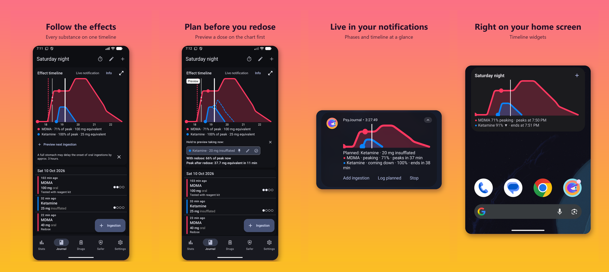

# PsyJournal

PsyJournal is a harm-reduction journal for Android, for people who use drugs. Log what you take, and the app shows how the effects should unfold, warns you about risky combinations and keeps safer-use information at hand. It works fully offline, and your journal never leaves your phone.

## Get it

Download the latest APK from the [releases page](https://github.com/FSeixasPT/PsyJournal/releases). It needs Android 8.0 or newer and installs next to the original PsychonautWiki Journal app. An F-Droid listing is on the way.

## What it does

### Keep a journal

- **Log each ingestion:** the substance, route, dose and time (or a time range), whether the dose is an estimate, how full your stomach was, who took it and any notes. Doses can be in your own units, such as pills or sprays.
- **Experiences:** ingestions taken close together are grouped into one experience, with a title, location, notes, Shulgin ratings and timed notes along the way.
- **Find things again:** browse the journal as a list or a calendar, search it, and star favorite experiences. Each row shows how long the experience lasted and how many ingestions and notes it has.

### See the effects over time

- **Effect timeline:** each experience gets a chart of how intense each substance should be over time, built from PsychonautWiki's onset, come-up, peak and offset durations. A "now" line shows where you are, and dragging across the chart shows each substance's share of its peak and the equivalent dose at that moment.
- **Plan before you redose:** preview a planned dose as a dashed line on the chart before you take it, to see how much higher and later the peak would be.
- **Live notification and widgets:** follow the current experience from the notification shade or your home screen, with each substance's phase (coming up, peaking, coming down) and when the next one starts.
- **Your view:** times can be clock times or relative to now or to the start, the shading can show the full range of known durations, and substances, ingestions or ratings can be hidden from the timeline without deleting them.

### Stay safer

- **Substance pages:** dosage ranges (threshold to heavy), durations per route, tolerance, interactions and safer-use tips, with a link to the full PsychonautWiki article.
- **Interaction warnings:** when you log a substance, PsyJournal checks it against what you've taken recently and warns you about dangerous or unsafe combinations.
- **Supplement routine:** optional hourly reminders for RollSafe's MDMA supplement routine and how much water to drink.
- **Frequency warnings:** PsyJournal tells you when you take MDMA, a psychedelic or ketamine again sooner than harm-reduction advice recommends, counting sessions rather than redoses.
- **Safer tab:** guides to researching a substance, drug checking services and reagent testing, dosing (including volumetric dosing), safer hallucinogen use and routes of administration.

### Understand your use

- **Stats:** how often you took each substance and the total doses over the last week, month, half year or year, with a chart.
- **Substance history:** every ingestion of a substance with the time between them, next to its tolerance information.

### Make it yours

- **Custom substances and units** for things PsychonautWiki doesn't cover or that you measure differently.
- **Colors:** pick each substance's color, including your own custom colors.
- **Routes:** hide routes you never use, or merge a substance's routes into one line on the timeline.

See [CHANGELOG.md](CHANGELOG.md) for what's new compared to PsychonautWiki Journal.

## Not medical advice

The information in PsyJournal comes from PsychonautWiki, with some from TripSit and saferparty.ch. It may be incomplete or wrong, and timelines are estimates: everyone reacts differently. PsyJournal can't make drug use safe. If you can, test your substances, start low, don't use alone, and get help in an emergency.

## Privacy

PsyJournal collects nothing and has no internet access: your journal stays on your device. See the [privacy policy](PRIVACY.md).

## Origin and credits

PsyJournal is a fork and continuation of [PsychonautWiki Journal](https://github.com/isaakhanimann/psychonautwiki-journal-android), created by **Isaak Hanimann**.
The original repository was archived after its last open-source (GPL-3.0) release, and later versions of the official app are closed-source.
PsyJournal builds on that last open-source release and is not affiliated with or endorsed by the original author.

Huge thanks to Isaak Hanimann and to everyone who contributed to the original project. The full commit history of the original project is preserved in this repository.

## Building and verifying releases

Release APKs on the [releases page](https://github.com/FSeixasPT/PsyJournal/releases) are signed with this certificate:

    SHA-256: B9:DA:7A:E5:F0:0C:C2:32:23:F4:58:20:83:5F:94:A3:26:14:9D:63:45:59:79:92:CD:66:01:EF:44:B7:04:8F

From 12.0 on, the build is reproducible: building a release tag from source gives the same APK as the published one, apart from the signature.

1. Use JDK 21. The Gradle wrapper pins Gradle 8.13, and the Android Gradle Plugin downloads the SDK platform and build tools it needs.
2. Check out the release tag, for example `git checkout v12.0`.
3. Build an unsigned release APK (the blank store file turns signing off):

       ./gradlew assembleRelease -PPSYJOURNAL_STORE_FILE=

4. Compare `app/build/outputs/apk/release/app-release-unsigned.apk` with the published APK, for example with [apksigcopier](https://github.com/obfusk/apksigcopier) `compare`, which ignores the signature.

The GitHub "Build and test" check prints the checksum of the unsigned release APK for every commit on `main`.

## License

    Copyright (C) 2022 Isaak Hanimann.
    Copyright (C) 2026 Francisco Seixas.

    This file is part of PsyJournal, a fork of PsychonautWiki Journal.

    PsyJournal is free software: you can redistribute it and/or modify
    it under the terms of the GNU General Public License as published by
    the Free Software Foundation, either version 3 of the License, or (at
    your option) any later version.

    PsyJournal is distributed in the hope that it will be useful,
    but WITHOUT ANY WARRANTY; without even the implied warranty of
    MERCHANTABILITY or FITNESS FOR A PARTICULAR PURPOSE.  See the
    GNU General Public License for more details.

    You should have received a copy of the GNU General Public License
    along with PsyJournal.  If not, see https://www.gnu.org/licenses/gpl-3.0.en.html.

The full license text is in [COPYING](COPYING).
